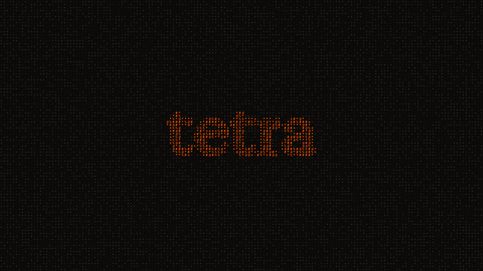

<p align="center">
  
</p>

<p align="center">
  Discord bot for managing emotes
  <br />
  <a href="https://tetra.lol">tetra.lol</a>
  ·
  <a href="https://tetra.lol/invite">add to discord</a>
  ·
  <a href="https://tetra.lol/editor">editor</a>
  ·
  <a href="https://github.com/ike-gg/Tetra/issues">issues</a>
</p>

---

## What it does

- **Add emotes from anywhere.** 7TV, BTTV, FFZ, a direct link, a Twitch channel's sub emotes, or an emote from someone else's message or reaction.
- **Fits them into Discord's limits.** Every emote is optimized automatically to Discord's 256 KB limit. There's nothing for the user to tweak.
- **Web panel.** Manage the emotes of every server you run, restore emotes that were removed, find emotes with similar names, browse 7TV and FFZ catalogs.
- **7TV channel sync** (experimental). Keeps a server's emotes in sync with a Twitch channel's 7TV set, with rules for what gets added.
- **Editor.** Crop, trim, resize and compress GIFs and images in the browser, without an account. Files never leave your device.
- **`/media`.** Downloads videos and images from social media posts.

## Commands

| command | does |
|---|---|
| `/addemote byname` | search 7TV, BTTV or FFZ by name |
| `/addemote bylink` | add from a link |
| `/addemote bychannel` | pick from a Twitch channel's emotes |
| `/addemote subemotes` | add a channel's Twitch sub emotes |
| `Steal emote here`, `Steal reaction` | add an emote from a message (context menu) |
| `File to emote` | turn an attached image or GIF into an emote (context menu) |
| `/media` | download media from a post |
| `/info`, `/invite`, `/help` | about, invite link, support |

## Monorepo

- [`apps/core`](apps/core): the Discord bot and the REST API the panel talks to. Adds and optimizes emotes, keeps the database and runs the 7TV sync.
- [`apps/web`](apps/web): the website, the panel for managing servers' emotes and the in-browser editor.

## Stack

- **Runtime:** Bun, TypeScript
- **Bot:** discord.js
- **API:** Hono, Zod
- **Data:** PostgreSQL with Drizzle, Redis with ioredis
- **Media:** sharp, gifsicle, yt-dlp, gallery-dl
- **Web:** TanStack Start, React, Tailwind CSS
- **Tooling:** Biome, Docker, Coolify

## Running locally

Requires [Bun](https://bun.sh) and Docker (for Postgres and Redis).

```sh
git clone https://github.com/ike-gg/Tetra
cd Tetra
bun install
cp apps/core/.env.example apps/core/.env   # fill it in, see docs/core.md
bun db:up                                  # Postgres + Redis
bun db:push                                # create the tables
bun --filter @tetra/core deploy:dev        # register commands on DEV_GUILDS
bun dev                                    # bot + API on :3002, web on :3000
```

Before committing, `bun check` (Biome) and `bun typecheck` must pass.

## Contributing

Issues and pull requests are welcome. For anything bigger than a fix, open an issue first so we can agree on the approach.
